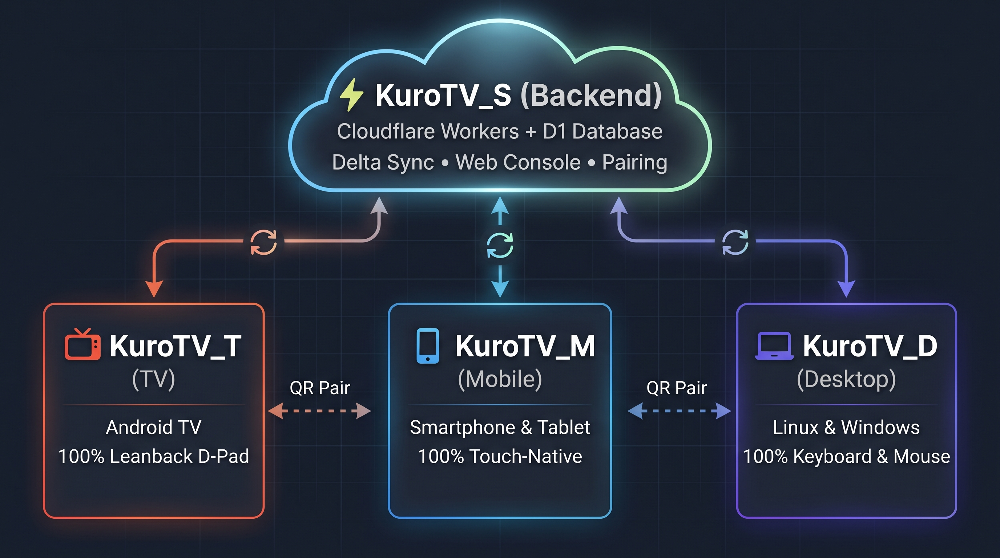
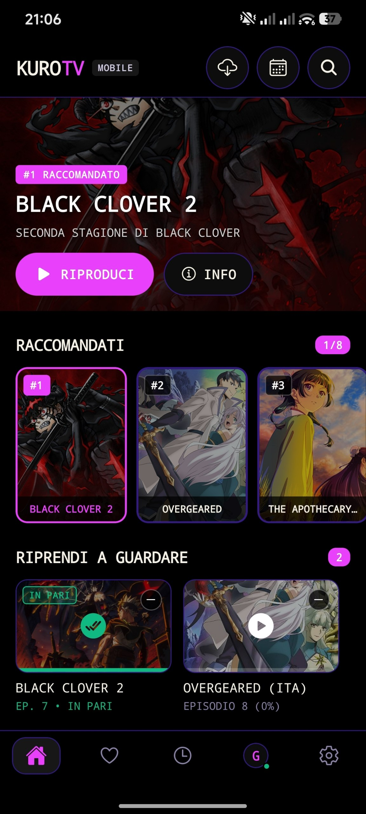
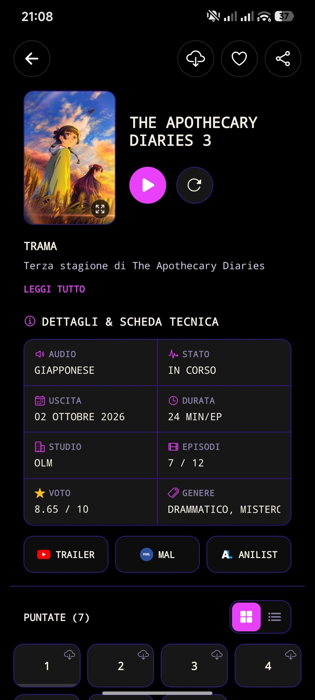
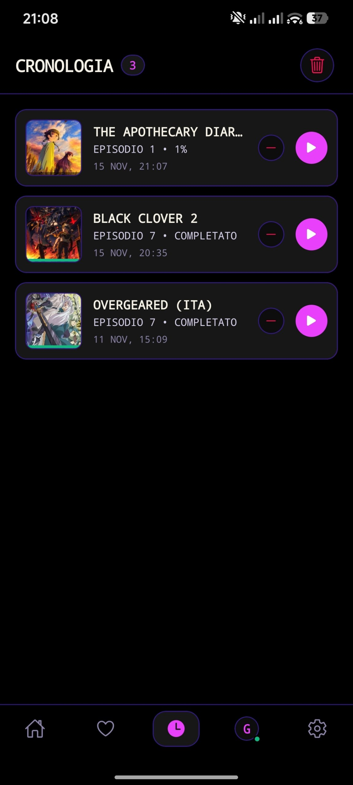

<div align="center">

# 📱 KuroTV Mobile (KuroTV_M)

### _Client Android touch-native per lo streaming anime, ad altissime prestazioni e nero assoluto OLED._

[](https://expo.dev/)
[](https://reactnative.dev/)
[](https://react.dev/)
[](https://hermesengine.dev/)
[](https://shopify.github.io/flash-list/)
[](https://github.com/mrousavy/react-native-mmkv)
[](https://android.com)
[](LICENSE)

<br />

**Kuro Mobile** è un client mobile open-source per Android (smartphone e tablet), concepito con architettura **100% touch-native**, estetica **OLED puro (`#000000`)** e integrazione nativa con l'ecosistema **KuroTV**.

</div>

---

## 🌐 L'Ecosistema Kuro

Kuro è una suite coordinata per lo streaming anime concepita per coprire ogni schermo senza dipendere da server centralizzati di terze parti:

<p align="center">
  
</p>

| Progetto | Piattaforma | Focus & Caratteristiche | Repository |
| :--- | :--- | :--- | :--- |
| **📱 KuroTV_M** | **Android Phone & Tablet** | Touch-native 120 FPS, Live Scrubbing, capitoli YouTube, download SAF, AniSkip. | [**G4s01/KuroTV_M**](https://github.com/G4s01/KuroTV_M) |
| **📺 KuroTV_T** | **Android TV & Google TV** | Interfaccia leanback 100% D-Pad, navigazione spaziale fluida, ExoPlayer TV. | [**G4s01/KuroTV_T**](https://github.com/G4s01/KuroTV_T) |
| **⚡ KuroTV_S** | **Cloudflare Workers + D1** | Backend serverless, delta sync deterministico, profili Netflix-style, pairing TV. | [**G4s01/KuroTV_S**](https://github.com/G4s01/KuroTV_S) |
| **🖥️ KuroTV_D** | **Desktop (In programma)** | Client desktop multipiattaforma in fase di pianificazione e sviluppo. | _In arrivo_ |

---

## 📸 Galleria Screenshot

### 📱 Esperienza Smartphone

<p align="center">
  
  
  
</p>
<p align="center">
  
  
  
</p>
<p align="center">
  <em>Home con Hero Spotlight, Player video touch immersivo, Scheda anime, Download offline SAF, Preferiti e Cronologia.</em>
</p>

### 💻 Esperienza Tablet & Grandi Schermi (≥ 600dp)

<p align="center">
  
</p>
<p align="center">
  <em>Interfaccia Tablet (<code>sw600dp</code>): Left Navigation Rail touch-native da 76dp con profilo rapido e layout a griglia estesa.</em>
</p>

---

## ✨ Funzionalità Chiave

### 🎬 Video Player Touch
- **Live Keyframe Scrubbing**: scorrimento a 60 FPS hardware con decodifica keyframe ExoPlayer su `expo-video` v58.
- **Capitoli in Stile YouTube**: progress bar segmentata con micro-gap discreti, colori dedicati per sigle/recap/post-credits, thumb coordinato e feedback aptico anti-jitter.
- **Time-Scrubbing HUD OLED**: orario target monospace, delta temporale colorato (`+02:45` / `-01:10`) e badge contestuale del capitolo.
- **AniSkip Intelligente**: skip automatico o manuale di intro/recap con durata configurabile (`5s`–`60s`/`∞`) e passaggio automatico a `'PROSSIMO'` all'ending.
- **Gesture Rapide**: doppio tap asimmetrico $\pm 10$s cumulativo e swipe verticali per volume (destra) e luminosità (sinistra).
- **Picture-in-Picture & Notifiche**: PiP senza pause e controlli a 5 tasti nei Quick Settings di Android 13+.

### 🔍 Ricerca & Filtri Avanzati
- **Architettura Anti-Drop IME**: campo di testo non controllato con `defaultValue` per azzerare la perdita di caratteri su tastiere terze (SwiftKey, Fleksy, Samsung).
- **Cronologia Stile Google**: ricerche recenti in MMKV con deduplicazione automatica dei prefissi parziali e cancellazione rapida.
- **Filtri Multi-Genere & Audio**: combinazione di 46 generi con logica `AND`, audio Doppiato/Sottotitolato e ordinamento per data reale.

### 📥 Download Offline & Storage SAF
- **Coda Sequenziale FIFO**: download a velocità massima su singolo thread per azzerare rate limiting.
- **Storage Access Framework (SAF)**: supporto flessibile a memoria interna, cartella _Download_ di sistema e MicroSD esterne.
- **Visione Offline Verificata**: riproduzione autonoma da file locale con badge dedicato e zero richieste di rete.
- **Opzione Solo Wi-Fi**: protezione contro il consumo accidentale di rete dati cellulare.

### ☁️ Sincronizzazione KuroSync & TV Pairing
- **Delta Sync Deterministico**: sincronizzazione incrementale su Cloudflare Workers + D1 con cursori scoped per profilo e cache tombstones anti-resurrezione.
- **Ottimizzazione Quote D1**: debounce del playback a 45-60s con salvataggio immediato su pausa, chiusura o termine puntata.
- **Accoppiamento TV Istantaneo**: autorizzazione Android TV in 1 secondo via scansione QR code o codice PIN a 6 cifre.
- **Profili Multipli Stile Netflix**: cambio rapido del profilo dalla barra di navigazione con switch atomico su cloud.

### 📅 Palinsesto & Programmazione
- **Calendario Settimanale**: programmazione uscite in tempo reale con orari di pubblicazione.
- **Hero Card Prossima Uscita**: scheda in evidenza con countdown e accesso immediato alla serie.
- **Timeline a Chip**: navigazione rapida per giorno con badge di stato (`USCITO`, `IN PAUSA`, `PROGRAMMATO`).

### 🖤 Design System OLED
- **Nero Assoluto (`#000000`)**: spegnimento completo dei pixel sui display AMOLED per il massimo risparmio energetico.
- **Tipografia Tecnica Monospace**: stile ad alto contrasto conforme YIQ per una leggibilità ottimale.
- **Zero CLS & Skeleton Animati**: transizioni fluide senza salti visivi durante il caricamento dei contenuti.
- **Zero Alert di Sistema**: conferme e avvisi gestiti esclusivamente tramite il componente modale in-app `ConfirmModal`.

---

## 🛠️ Stack Tecnologico

| Componente | Tecnologia | Ruolo & Caratteristiche |
| :--- | :--- | :--- |
| **Framework** | **Expo SDK 58** & **React Native 0.88** | Nuova architettura Fabric e TurboModules nativi |
| **Runtime JS** | **Hermes Engine** | Bytecode precompilato ultra-rapido a basso consumo RAM |
| **Routing** | **Expo Router v58** | File-based routing dichiarativo (Stack e Bottom Tabs) |
| **Virtualizzazione** | **@shopify/flash-list v2** | Rendering griglie e liste infinite a 60/120 FPS |
| **Storage Locale** | **react-native-mmkv v3** | Key-value store sincrono zero-latency in C++ |
| **Player Video** | **expo-video** | Decodifica hardware HLS/MP4, PiP e Live Scrubbing |
| **Data Fetching** | **@tanstack/react-query v5** | Caching asincrono e deduplicazione delle richieste |
| **Scraper Core** | **cheerio/slim** + **htmlparser2** | Parsing HTML puro JavaScript 100% compatibile Hermes |
| **Fotocamera** | **expo-camera (CameraView)** | Scansione QR code touch-native senza permessi audio |

---

## 📦 Tooling & Pipeline di Release

Gli script in [`scripts/`](./scripts) automatizzano il ciclo di compilazione e rilascio:

```bash
# Compilazione APK release arm64-v8a con bytecode Hermes:
./scripts/build-release.sh

# Finalizzazione rapida di un binario già compilato (senza rebuild):
./scripts/build-release.sh --skip-build

# Backup cifrato AES-256-CBC di keystore e credenziali su Cloudflare R2:
./scripts/backup-secrets-r2.sh
```

> [!NOTE]
> `build-release.sh` aggiorna automaticamente `src/constants/changelog.ts` e compila il manifest OTA per Cloudflare Workers/R2, garantendo che le note di rilascio in-app siano sempre allineate alla versione distribuita.

---

## 📚 Documentazione di Dettaglio

- 🏛️ [**Architettura del Progetto**](./docs/ARCHITECTURE.md) — Moduli, routing, storage e convenzioni operative
- 🎬 [**Specifiche Video Player**](./docs/VIDEO_PLAYER.md) — Live keyframe scrubbing, capitoli timeline e AniSkip
- 🎨 [**Temi & Design System**](./docs/THEMES_AND_STYLING.md) — Token OLED, palette e contrasto dinamico YIQ
- 🚀 [**Pipeline OTA & Rilasci**](./docs/OTA_AND_RELEASES.md) — Distribuzione in-app updater su Cloudflare R2
- 📱 [**Regole Architetturali Tassative**](./AGENTS.md) — Linee guida e standard ingegneristici per Kuro Mobile

---

## ⚖️ Disclaimer Legale

Questo software è distribuito esclusivamente per scopi didattici, di ricerca e per uso personale.  
**KuroTV Mobile** non ospita, non memorizza e non distribuisce alcun file multimediale sui propri server; l'applicazione funge unicamente da client di interfaccia touch verso sorgenti web pubblicamente accessibili. Gli utenti sono gli unici responsabili della conformità con i termini di servizio dei fornitori di contenuti e con le normative locali sul copyright.

---

<div align="center">

_Sviluppato per l'ecosistema Kuro • Mobile-First & Touch-Native_

</div>
