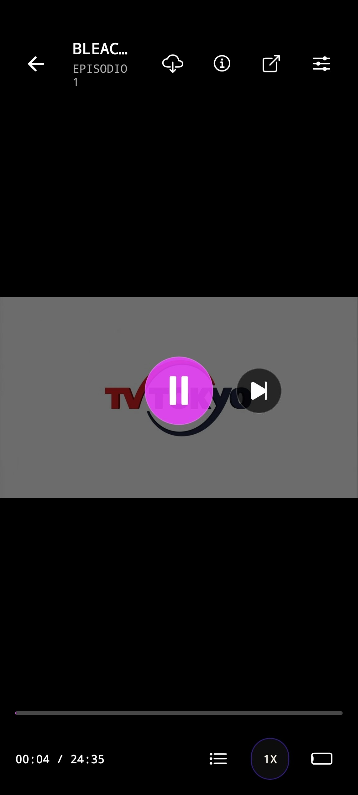
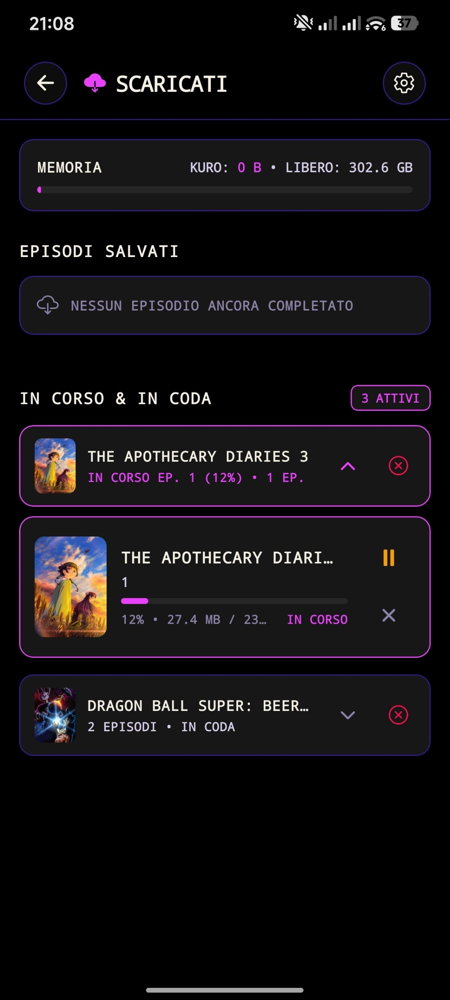
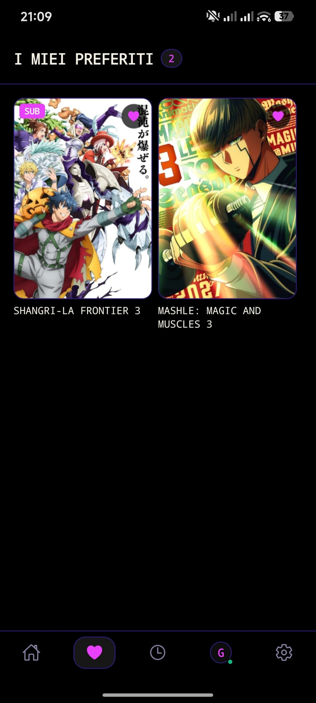
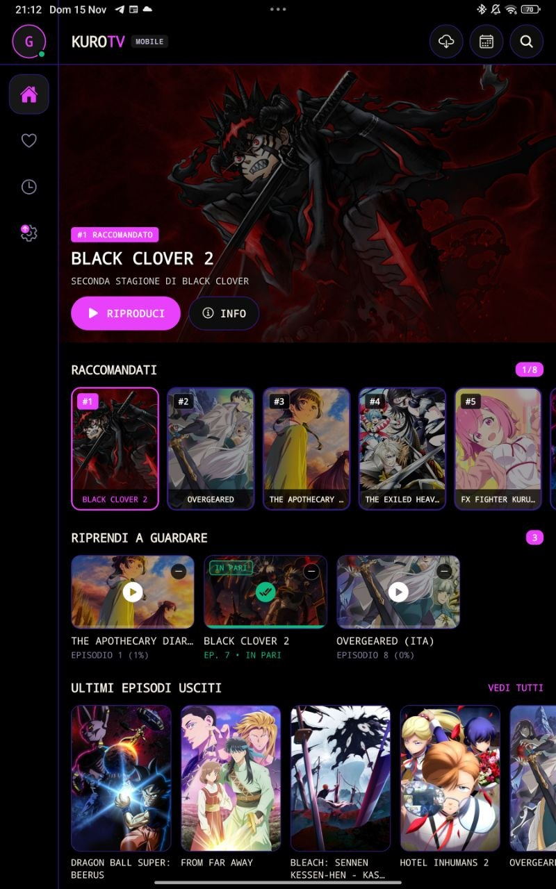

<div align="center">

# 📱 KuroTV Mobile (KuroTV_M)

### *Client Android touch-native per lo streaming anime, ad altissime prestazioni e nero assoluto OLED.*

[](https://expo.dev/)
[](https://reactnative.dev/)
[](https://react.dev/)
[](https://hermesengine.dev/)
[](https://shopify.github.io/flash-list/)
[](https://github.com/mrousavy/react-native-mmkv)
[](https://android.com)
[](LICENSE)

<br />

**Kuro Mobile** è un client mobile moderno e open-source per Android (smartphone e tablet), concepito da zero con architettura **100% touch-native**, estetica **OLED puro (`#000000`)** e perfetta integrazione con l'ecosistema **KuroTV**.

</div>

---

## 🌐 L'Ecosistema Kuro

Kuro è una suite completa e sincronizzata per lo streaming anime concepita per coprire qualsiasi schermo e dispositivo, senza dipendere da server centralizzati di terze parti:

```
                      ┌──────────────────────────────────────┐
                      │        ⚡ KuroTV_S (Backend)          │
                      │  Cloudflare Workers + D1 Database    │
                      │  Delta Sync • Web Console • Pairing  │
                      └──────────────────┬───────────────────┘
                                         │
                   ┌─────────────────────┴─────────────────────┐
                   ▼                                           ▼
      ┌─────────────────────────┐                 ┌─────────────────────────┐
      │   📱 KuroTV_M (Mobile)   │                 │     📺 KuroTV (TV)      │
      │   Smartphone & Tablet   │  ◄── QR Pair ─► │       Android TV        │
      │   100% Touch-Native     │                 │   100% Leanback D-Pad   │
      │   Visione Offline & SAF │                 │  Navigazione Spaziale   │
      └─────────────────────────┘                 └─────────────────────────┘
```

| Progetto | Piattaforma | Focus & Caratteristiche Chiave | Repository |
| :--- | :--- | :--- | :--- |
| **📱 KuroTV_M** *(questo repo)* | **Smartphone & Tablet Android** | Interfaccia touch-first a 60/120 FPS, Live Frame Scrubbing, download offline SAF, AniSkip, layout responsive adattivo per tablet (`sw600dp`). | [*Sei qui*](https://github.com/G4s01/KuroTV_M) |
| **📺 KuroTV** | **Android TV / Google TV** | Esperienza leanback da salotto, navigazione spaziale 2D fluida per telecomando D-Pad, zero cursori virtuali, ExoPlayer TV pro. | [**G4s01/KuroTV**](https://github.com/G4s01/KuroTV) |
| **⚡ KuroTV_S** | **Cloudflare Workers + D1** | Backend di sincronizzazione self-hosted serverless (100% Free Plan), delta sync deterministico, profili stile Netflix, TV pairing QR/PIN. | [**G4s01/KuroTV_S**](https://github.com/G4s01/KuroTV_S) |

---

## 📸 Galleria Screenshot

### 📱 Esperienza Smartphone
<p align="center">
  
  
  
</p>
<p align="center">
  
  
  
</p>
<p align="center">
  <em>In alto: Home con Hero Spotlight, Player video touch immersivo, Scheda tecnica con metadati.<br />
  In basso: Download offline e storage SAF, Catalogo preferiti salvati, Cronologia con avanzamento episodi.</em>
</p>

### 💻 Esperienza Tablet & Grandi Schermi (≥ 600dp)
<p align="center">
  
</p>
<p align="center">
  <em>Interfaccia Tablet (<code>sw600dp</code>): Left Navigation Rail touch-native da 76dp con profilo rapido, Top Bar allineata ed Hero Banner a tutta larghezza.</em>
</p>

---

## ✨ Funzionalità Chiave

### 🎬 Player Video Touch di Nuova Generazione
- **🎞️ Live Real-Frame Scrubbing**: Trascina la timeline per visualizzare in tempo reale i fotogrammi estratti dallo stream video (`expo-video`), senza interruzioni e a 60 FPS.
- **⏭️ AniSkip Intelligente (`SALTA` / `PROSSIMO`)**: Rilevamento automatico delle sigle (`OP`/`ED`/`Recap`) con durata configurabile (`5s`–`60s` o `∞`). Passaggio automatico e intelligente a `'PROSSIMO'` all'ending o alla scena post-credit.
- **⏩ Gesture Seeking Asimmetrico**: Doppio tocco $\pm 10$s cumulativo (`+20s`, `+30s`...) e HUD verticali per volume (destra) e luminosità (sinistra).
- **📺 Picture-in-Picture & MediaStyle Notification**: Supporto nativo PiP senza pause e controlli multimediali in notifica a 5 pulsanti (`KuroForwardingPlayer`) con artwork JPEG ad alta risoluzione nei Quick Settings di Android 13+.

### 📥 Download Offline & Storage SAF
- **⚡ Coda Sequenziale FIFO**: Download a velocità massima su singolo thread per azzerare rate limiting e rendere fruibile il primo episodio nel minor tempo possibile.
- **📁 Storage Access Framework (SAF)**: Supporto flessibile alla memoria interna dell'app, alla cartella *Download* di sistema o a schede MicroSD esterne.
- **📶 Vincolo Solo Wi-Fi**: Protezione opzionale per evitare il consumo involontario di dati mobili.
- **🎬 Modalità Offline Resiliente**: Riproduzione locale verificata con badge `LOCALE / OFFLINE` e zero richieste di rete durante il playback.

### ☁️ Sincronizzazione Self-Hosted KuroSync & TV Pairing
- **🔄 Delta Sync Deterministico**: Sincronizzazione in background di preferiti, cronologia, stato `"IN PARI"`, ricerche recenti e progressi episodio con dominanza dei tombstones.
- **⏱️ Cloudflare D1 Optimization**: Debounce del playback a 45-60s per rispettare i limiti del piano gratuito di Cloudflare, con flush immediato su pausa, chiusura o completamento.
- **📺 Accoppiamento TV Istantaneo**: Autorizza la tua Android TV in 1 secondo scansionando il QR visualizzato sullo schermo della TV con la fotocamera dello smartphone o inserendo il codice a 6 cifre.
- **👥 Profili Multipli Stile Netflix**: Cambio rapido del profilo direttamente dalla barra di navigazione o tramite selettore touch dedicato.

### 📅 Palinsesto & Programmazione Settimanale
- **🗓️ Calendario Uscite in Tempo Reale**: Programmazione settimanale completa con gli orari di pubblicazione delle puntate.
- **🔥 Hero Card "Prossima Uscita"**: Card in evidenza con countdown e accesso diretto alla serie in procinto di uscire.
- **⏱️ Timeline Virtualizzata**: Visualizzazione fluida dei giorni della settimana con chip touch e badge di stato cromatici (`USCITO`, `IN PAUSA`, `PROGRAMMATO`).

### 🖤 Design System OLED & Ottimizzazioni Native
- **Nero Assoluto (`#000000`)**: Spegnimento completo dei pixel sui display AMOLED per il massimo risparmio energetico.
- **Tipografia Tecnica Monospace**: Stile distintivo coerente con testi in maiuscolo e contrasto dinamico YIQ.
- **Skeleton Animati a Zero CLS**: Nessun salto visivo di layout durante il caricamento grazie a geometrie placeholder speculari ai componenti reali.
- **Zero Alert di Sistema**: Tutte le conferme adottano il modale in-app unificato `ConfirmModal` a tema OLED con feedback aptico.

---

## 🛠️ Stack Tecnologico

| Componente | Tecnologia | Ruolo & Motivazione |
| :--- | :--- | :--- |
| **Framework** | **Expo SDK 58** & **React Native 0.88** | TurboModules nativi & nuova architettura Fabric |
| **Runtime JS** | **Hermes Engine** | Esecuzione bytecode precompilato ultra-rapida a basso consumo RAM |
| **Routing** | **Expo Router v58** | File-based routing dichiarativo con Stack e Bottom Tabs |
| **Virtualizzazione** | **@shopify/flash-list v2** | Liste e griglie infinite a 60/120 FPS costanti |
| **Storage Locale** | **react-native-mmkv v3** | Key-value store sincrono C++ ad alte prestazioni |
| **Player Multimediale** | **expo-video** | Player HLS moderno, PiP, stream asincrono e gesture touch |
| **Data Fetching** | **@tanstack/react-query v5** | Caching, deduplicazione delle richieste e reattività |
| **Scraper Core** | **cheerio/slim** + **htmlparser2** | Parser HTML 100% puro JavaScript compatibile con Hermes |
| **Fotocamera** | **expo-camera (CameraView)** | Scansione QR per accoppiamento TV senza permessi audio invasivi |

---

## 🚀 Guida Rapida per Sviluppatori

### 1. Prerequisiti
- **Node.js** $\ge 18$
- **Android Studio** & Android SDK (API 34+)
- Dispositivo Android fisico o emulatore con architettura `arm64-v8a`

### 2. Installazione
```bash
# Clona il repository
git clone https://github.com/G4s01/KuroTV_M.git
cd KuroTV_M

# Installa le dipendenze
npm install
```

### 3. Suite di Test Qualitativa (32 Stadi)
Il progetto include una suite esaustiva di 32 stadi che convalida regole OLED, storage MMKV, AniSkip, gesture, compatibilità tablet, resilienza offline e sicurezza:
```bash
npm test
```

### 4. Avvio su Dispositivo Android
```bash
# Genera ed esegue il client su dispositivo/emulatore Android collegato
npm run android
```

---

## 📦 Tooling & Pipeline di Release

Gli script in [`scripts/`](./scripts) automatizzano il processo di build, firma e distribuzione:

```bash
# Compilazione APK release arm64-v8a con packaging Hermes:
./scripts/build-release.sh

# Finalizzazione rapida di un binario già compilato (senza rebuild):
./scripts/build-release.sh --skip-build

# Backup cifrato con AES-256-CBC di keystore e segreti su Cloudflare R2:
./scripts/backup-secrets-r2.sh
```

---

## 📚 Documentazione di Dettaglio

Per esplorare l'architettura tecnica e le decisioni di design:
- 🏛️ [**Architettura del Progetto**](./docs/ARCHITECTURE.md) — Dettagli su moduli, routing e lifecycle
- 🎬 [**Specifiche Video Player**](./docs/VIDEO_PLAYER.md) — Funzionamento scrubbing, AniSkip e PiP
- 🎨 [**Temi & Design System**](./docs/THEMES_AND_STYLING.md) — Token OLED, palette e contrasto dinamico YIQ
- 🚀 [**Pipeline OTA & Rilasci**](./docs/OTA_AND_RELEASES.md) — Configurazione updater in-app su Cloudflare R2
- 📱 [**Regole Architetturali Tassative**](./AGENTS.md) — Standard di codice e anti-pattern TV vietati

---

## ⚖️ Disclaimer Legale

Questo software è distribuito esclusivamente per scopi didattici, di ricerca e per uso personale.  
**KuroTV Mobile** non ospita, non memorizza e non distribuisce alcun file multimediale sui propri server; l'applicazione funge unicamente da client di interfaccia touch verso sorgenti web pubblicamente accessibili. Gli utenti sono gli unici responsabili della conformità con i termini di servizio dei fornitori di contenuti e con le normative locali sul copyright.

---

<div align="center">

*Sviluppato con passione per l'ecosistema Kuro • Mobile-First & Touch-Native*

</div>
